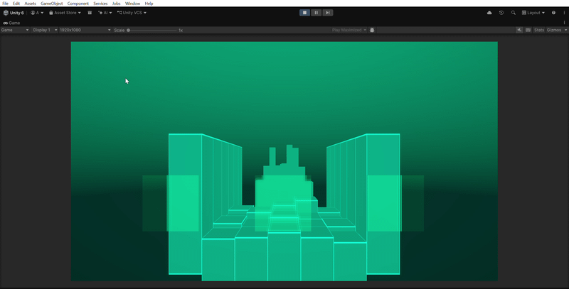

Procedural 3D glass fracturing for Unity. Generate volumetric cube fragments with spiderweb-like fracture patterns at runtime, preserving UVs and normals.

## Features

- **Runtime Fracturing** — fracture geometry is generated dynamically during gameplay.
- **Volumetric Geometry** — supports cube-shaped meshes.
- **Spiderweb Fracture Pattern** — generates a characteristic spiderweb-like crack pattern across the glass surface.
- **Mesh Attribute Preservation** — transfers UV coordinates and vertex normals from the original mesh to the generated fragments.
- **Optional Physics Simulation** — generated fragments can optionally be used with Unity's physics system.
- **No Pre-Fractured Assets** — fracture geometry is generated at runtime without requiring predefined fracture patterns.

